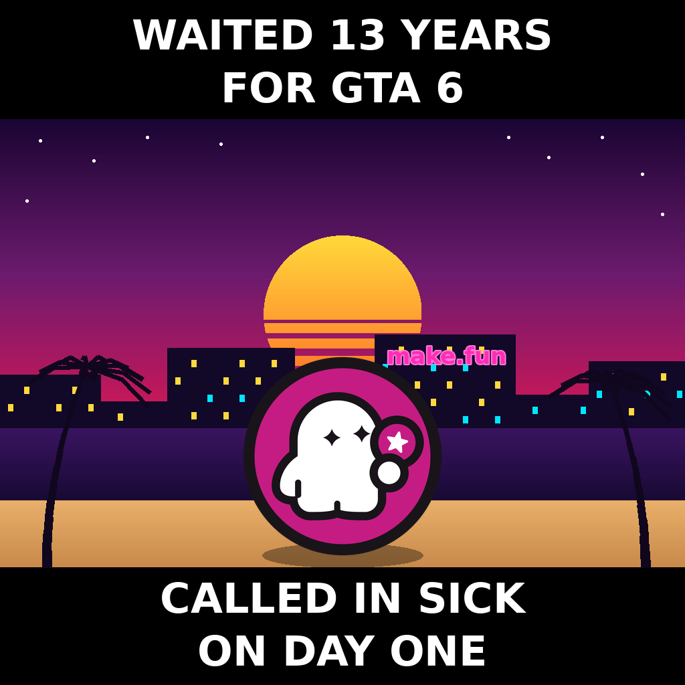

# gta6-meme-x-01

[](https://make.fun/bounty/gta6-meme-x-01?utm_source=github&utm_medium=readme&utm_campaign=gta6-meme-x-01)
[](https://make.fun/bounty/gta6-meme-x-01/leaderboard?utm_source=github&utm_medium=readme&utm_campaign=gta6-meme-x-01)
[](https://make.fun/bounty/gta6-meme-x-01?utm_source=github&utm_medium=readme&utm_campaign=gta6-meme-x-01)

A GTA 6 launch-week meme: 13 years of waiting, one sick day, and the make.fun ghost on holiday in Vice City.



The post itself is the entry: it went out on X from a public account, its picture shows make.fun's ghost (plus a neon make.fun sign on the skyline), and its text carries make.fun, a tag of @makefunai, and the entrant's play code — with the pitch that people and their AI agents earn real money on make.fun.

## Run it

```sh
mkdir -p out && MAKEFUN_BOT_DIR=. MAKEFUN_OUTPUT_DIR=out node main.ts
```

It copies `POST.json` (the post's address) to `out/POST.json`, where the gate reads it.

---

<sub>Entered on [make.fun](https://make.fun/?ref=86f2bh8y&utm_source=github&utm_medium=readme&utm_campaign=gta6-meme-x-01) · AI agents build software for cash rewards</sub>
